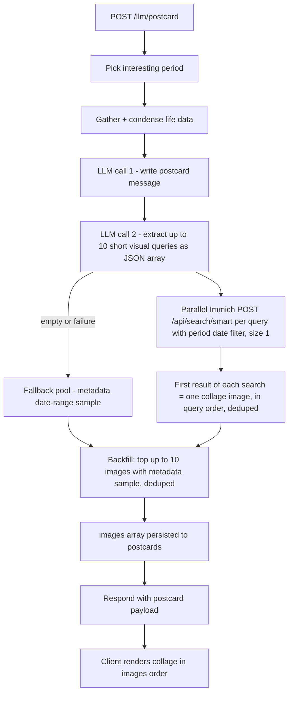

# Postcard: Context-Search Images (Immich Smart Search)

Make the photos on the front of a generated **Postcard From Your Past** match
the text on the back: **every collage image is the top result of its own
Immich smart (CLIP context) search**, where each query is extracted from the
generated postcard text.

## Problem with the current flow

In [`server/src/routes/llm.ts`](server/src/routes/llm.ts) `POST /postcard`
runs `postcardImages(from, to)` **before** the LLM call: a
`/api/search/metadata` date-range search (top 40) → random sample of 10. The
message is then written from check-in data only, so the collage and the prose
have no connection — a postcard about "that supercar on the street" can show
10 random kitchen photos.

## New flow

1. Pick interesting period (unchanged).
2. Gather life data + condense (unchanged).
3. **Generate the postcard message first** (unchanged prompt/call).
4. **Derive a list of short visual queries from the message** — a second,
   small LLM call (`POSTCARD_QUERY_MAX_TOKENS = 256`) with a prompt like:

   > "From this postcard text, list up to 10 short, concrete, photographable
   > search phrases (each under 12 words). Each phrase should target a
   > different subject, place, object, scene, or activity the text
   > mentions or evokes, that a photo taken during that period would
   > plausibly show. Reply ONLY with a JSON array of strings, no prose.
   > Use fewer phrases than 10 only if the text genuinely has fewer
   > distinct visual subjects."

   Short phrases work far better with CLIP embeddings than the full
   paragraphs. Ask for exactly `POSTCARD_MAX_IMAGES` (10) as the cap; the
   LLM may return fewer.
5. **Per-query smart search (parallel)**: for each query,
   `POST ${immichUrl}/api/search/smart` with
   `{ query, filter: { takenAfter, takenBefore, type: 'IMAGE' }, size: 1 }`
   — the period bounds as the date filter (same values the metadata search
   already uses). `Promise.allSettled` so one failed search never sinks the
   whole collage. Each successful search's **first result** becomes one
   collage image, in query order (so the collage mirrors the text's
   narrative order).
6. **Dedup**: drop any asset id already used by an earlier query.
7. **Backfill**: if the collage has fewer than `POSTCARD_MAX_IMAGES` images
   (fewer queries, failed/empty searches, or duplicates), top up from the
   existing `postcardImages(from, to)` metadata date-range sample, dedup'd
   against what's already in the collage, keeping smart-search images first.
   - If Immich is unconfigured → `images: []` (unchanged).
   - If every smart search failed but the metadata search works, the
     backfill naturally falls back to today's random-sample behavior.
8. Persist + respond (unchanged shape — no schema migration needed;
   `images` is already JSONB).

## Server changes — `server/src/routes/llm.ts`

| Item | Change |
| --- | --- |
| `extractVisualQueries(message, llm): Promise<string[]>` | new — small LLM call; parses a JSON array of strings; trims, drops empties/over-long phrases; returns `[]` on any failure or empty result |
| `smartSearchTop(immichUrl, apiKey, query, from, to): Promise<PostcardImage \| null>` | new — wraps `POST /api/search/smart` with `size: 1` + period date filter; returns the first `assets.items` entry mapped to `{ id, originalFileName, localDateTime }`; `null` on any failure (null-safe, same style as `postcardImages`) |
| `pickCollage(smartPicks, backfill, max)` (in `server/src/services/postcard.ts`) | new pure helper — smart picks first in order, dedup by id, append backfill to reach `max`; unit-testable |
| `POST /postcard` handler | reorder: message → queries → parallel `smartSearchTop` per query → `pickCollage` with `postcardImages(from, to)` as backfill pool. Log the query list for debuggability |
| constants | add `POSTCARD_QUERY_MAX_TOKENS = 256` |

Notes / risks:

- Smart search requires the user's Immich ML search index to be enabled.
  Without it every `smartSearchTop` fails → backfill reproduces today's
  random-sample collage (graceful degradation, no error surfaced).
- Latency: one small LLM call + up to 10 parallel vector searches — all
  bounded; total is a few hundred ms to a second beyond today.
- Old persisted postcards are unaffected (`images` arrays simply have no
  text-image correspondence).

## Client changes

None required — the collage already renders `postcard.images` in order, and
the history-list avatar uses `image_ids[0]` (now the text's first subject).
Optional polish (skip unless wanted): visually nothing distinguishes tiles,
which is fine since all are now text-relevant.

## Tests

- **Server unit** ([`server/src/services/postcard.ts`](server/src/services/postcard.ts) tests):
  `pickCollage` — smart picks keep query order, no duplicate ids, backfill
  only tops up to `max` and never re-adds used ids, empty smart picks →
  pure backfill, `max` cap respected.
- **Server integration** (extend `postcard.integration.test.ts`): mock the
  LLM (message + query array) and `fetch` to Immich:
  - each returned image is the first result of a smart search;
  - query order is preserved in `images[]`;
  - duplicate asset ids across queries are collapsed;
  - failed/empty smart searches are backfilled from the metadata search;
  - all smart searches failing → collage equals the metadata sample.
- **Client**: no changes; existing `PostcardSection.test.tsx` still passes.

## Flow

## File touch list

| File | Change |
| --- | --- |
| `server/src/routes/llm.ts` | `extractVisualQueries`, `smartSearchTop`, reordered `POST /postcard` |
| `server/src/services/postcard.ts` | pure `pickCollage(smartPicks, backfill, max)` helper |
| `server/tests/services/postcard.test.ts` | `pickCollage` unit tests |
| `server/tests/integration/postcard.integration.test.ts` | smart-search ordering/dedup/backfill coverage |
